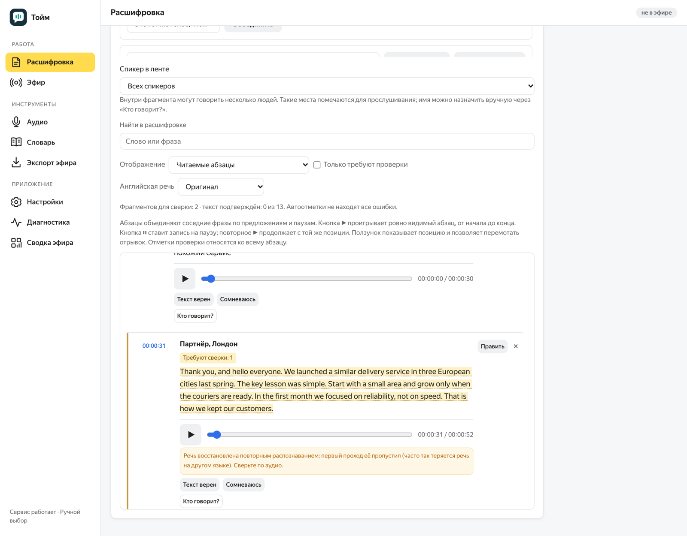
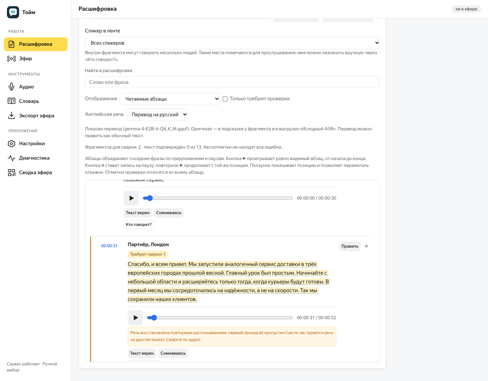
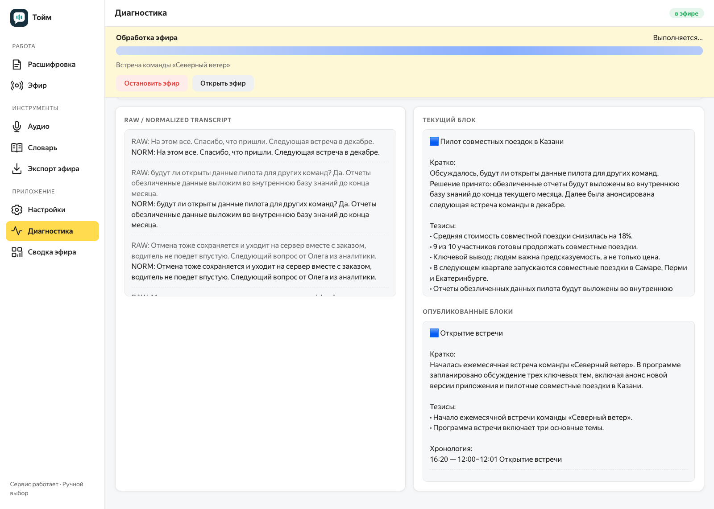
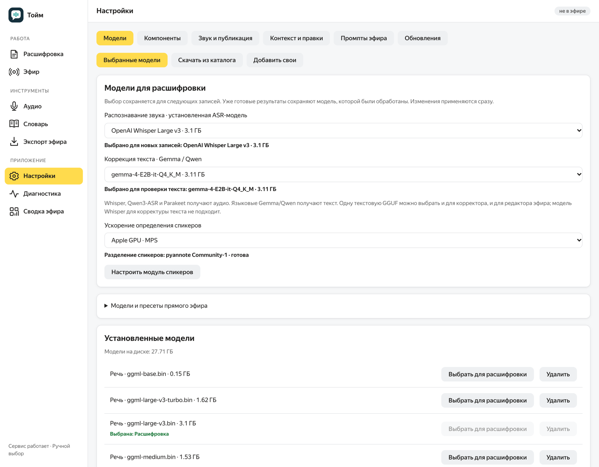

# Тойм

Настольное приложение для полной расшифровки записей и текстовой трансляции
эфира. Работает **целиком на компьютере пользователя**: записи, расшифровки и
модели никуда не отправляются. Облачные модели, облачное распознавание и
телеметрия не используются.

> Это демонстрационная страница проекта. Исходный код и установщики хранятся в
> закрытом репозитории. Здесь — описание, скриншоты и файлы для встроенного
> обновления уже установленных копий. Чтобы получить приложение, обратитесь к владельцу.

## Что умеет

**Полная расшифровка записей.** Аудио- и видеофайлы или запись с устройства:
- **Текст по спикерам.** Абзацы делятся по говорящим, их можно переименовывать,
  объединять и назначать вручную.
- **Прослушивание.** Можно прослушать любой абзац.
- **Отметки проверки.** «Текст верен» и «Сомневаюсь» ставятся на абзац целиком.
- **Правка.** Можно поправить весь абзац сразу, таймкоды и субтитры при этом
  остаются точными.
- **Безопасная работа с текстом.** Абзац можно исключить из выгрузки и вернуть,
  а правки — откатить к распознанному тексту.
- **Выгрузка:** TXT, DOCX, Markdown, SRT, VTT, JSON.

**Английская речь в русской записи.** Распознаётся по-английски, а не
пересказывается по-русски. Пропущенные распознаванием иноязычные выступления
восстанавливаются. Для чтения английские фрагменты можно показать в переводе на
русский — его делает локальная модель, оригинал сохраняется.

**Пунктуация и проверка слов.** Знаки препинания расставляет само распознавание
(Whisper). Для движков без своей пунктуации их расставляет локальная языковая
модель. По кнопке она же предлагает исправления имён и терминов, каждое можно
прослушать, принять или отклонить.

**Текстовая трансляция эфира.** Тойм слушает выступление, встречу или
трансляцию и в реальном времени ведёт текстовую трансляцию в закрытом чате
Telegram или Яндекс Мессенджера:
- **Звук откуда угодно.** Микрофон, аудиоинтерфейс, виртуальный кабель или
  прямо звук приложений — Zoom, Телемост, браузер (macOS 14.4+), без
  виртуальных кабелей. Перед эфиром — проверка сигнала с индикатором уровня в
  реальном времени.
- **Смысловые блоки.** Локальная языковая модель собирает из распознанной речи
  блоки с выжимкой, тезисами и хронологией. Блок — одно сообщение, которое
  дополняется правкой по ходу темы, а не засыпает чат повторами.
- **Вопросы из зала** собираются в отдельное сообщение вместе с ответами.
- **Итог** со списком обсуждённых тем — после остановки.
- **Программа эфира** задаёт границы блоков и правильное написание имён.
  **Словарь** исправляет термины, в том числе в уже отправленных сообщениях.
- **Контроль.** Сводка эфира (сигнал, задержка, загрузка компьютера,
  опубликованное) и монитор с распознанным текстом. Пробный эфир из файла,
  режим «только локально» для репетиции, экспорт текста и блоков.
- **Только выжимки.** В чат уходят обработанные блоки, сырой распознанный текст
  не публикуется.

**Модели на выбор.** Whisper (Large v3 Turbo по умолчанию, Large v3 и др.),
GigaAM, Parakeet, Qwen3-ASR для распознавания; Gemma, Qwen для текста; pyannote
для спикеров. Модели скачиваются и переключаются в настройках. Качество
проверяется на эталонных записях с расшифровкой, выверенной вручную: модели и
настройки по умолчанию меняются только по результатам замеров.

**Подстройка под компьютер.** Тойм определяет процессор, видеочип и память и
подбирает под них порядок работы: потоки, параллельную обработку, одновременный
запуск этапов. Модели и точность при этом не меняются.

**Простой и расширенный режимы.** В простом — только расшифровка записи и эфир
одной кнопкой, модели и параметры по умолчанию. В расширенном — всё: выбор
моделей, параметры, проверка текста, сравнение вариантов, словарь, диагностика.
Режим выбирается при первом запуске и переключается в любой момент.

**Обновления.** «Настройки → Обновления» и плашка «Обновить»: приложение само
находит новую версию, проверяет её подпись и устанавливает. Записи и модели не
трогаются, база перед обновлением копируется.

## Как устроено

- **Оболочка:** Tauri 2 / Rust — окно, меню, обновления.
- **Обработка:** Python 3.12 / FastAPI на локальном порту.
- **Интерфейс:** TypeScript.
- **Движки:** whisper.cpp и llama.cpp с ускорением на Apple Silicon (Metal).
- **Платформа:** macOS 14+ на Apple Silicon. Сборка для Windows x64 готовится.

## Релизы

В релизах этого репозитория — описания версий и файлы для встроенного обновления
(`latest.json`, подписанный архив). Установщиков здесь нет.

Скриншоты сняты на выдуманных записях встреч: голоса синтезированы, совпадения
с реальными людьми и компаниями случайны.
